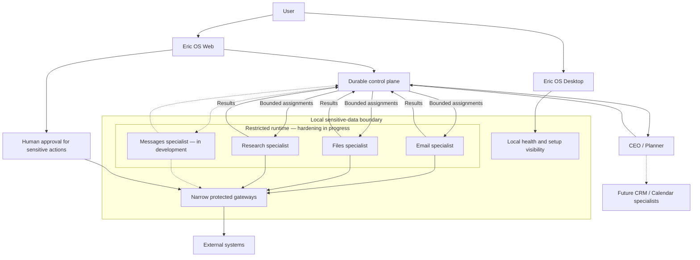

# Eric OS

**A security-first multi-agent AI system for small businesses that need useful work done without managing agents, APIs, or infrastructure.**

Eric OS brings a central planner, focused specialists, and human approvals into one operating environment. The aim is to make advanced AI automation practical for businesses that cannot dedicate a team to building and maintaining it.

> **Public showcase · Active early-stage project · Private implementation**
>
> This repository contains architecture notes and sanitized examples. It is not an open-source release, an installable product, or a copy of the production codebase. See [NOTICE.md](NOTICE.md).

[Architecture](docs/ARCHITECTURE.md) · [Security](docs/SECURITY.md) · [Vision](docs/VISION.md) · [Roadmap](docs/ROADMAP.md)

## What is Eric OS?

Eric OS is an application-level operating system for AI-assisted business work. A web dashboard provides visibility and review, a Mac desktop companion reports local health, and a local runtime executes bounded assignments.

A CEO/planner coordinates specialists for email, files, and research. Messaging is in development; CRM and Calendar are planned. Each specialist returns a result to the planner rather than deciding the whole workflow itself.

The useful unit is an outcome: finding the right document, checking a fact, preparing a response, or bringing a decision to the person responsible for it.

## Why I built it

There is a gap between what frontier AI can do and what a normal business can actually deploy. A business owner should not need to learn an agent framework, manage credentials, or debug a workflow just to get help with everyday operations.

I am building Eric OS to bridge that gap. The engineering work is as much about permissions, recovery, setup, and clear controls as it is about the models. Automation needs to fit the way a business works and make it clear when a person still needs to decide.

## How it works

1. A business request or an enabled integration starts a workflow.
2. The CEO/planner interprets the goal and assigns a bounded task to a specialist.
3. The specialist uses its permitted capabilities and returns a result, including missing information or uncertainty.
4. Durable workflow state brings the result back to the planner, which chooses the next step or asks the user for input.
5. Sensitive outbound actions go through a separate approval and execution boundary. A model's suggestion does not authorize an action.

A workflow can wait for a result or a human decision and continue from recorded state. This does not mean every interrupted job is automatically resumed: uncertain or failed actions need review before retrying. Avoiding duplicate outbound work matters more than hiding a failure.

A fictional example: the planner asks the Files specialist for a product guide, gets an ambiguous result, and asks the user which guide they meant. Once clarified, an Email specialist can prepare a response for review. The examples below illustrate the handoff; they are not executable production contracts.

## Architecture overview

This is a simplified design view. Dashed connections indicate development or planned work. The local boundary shows where sensitive processing belongs; it does not imply that all data stays on the Mac or that cloud services are absent. [Architecture notes](docs/ARCHITECTURE.md) explain the boundaries and current limits.

## Current capabilities

“Implemented” below means present in the private source inspected for this showcase. It does not certify that a connection is active, an agent is enabled, or a feature is ready for general deployment.

| Area | Present in the private implementation | Stage / limits |
| --- | --- | --- |
| Web dashboard | Authenticated workspace access, agent activity, workflow state, and approval review | Implemented; configuration and access are required |
| CEO/planner | Bounded assignments and continuation after specialist results or decisions | Implemented; scope is still evolving |
| Email | Gmail connection flow, analysis, reply preparation, and protected sending | Implemented paths; sending depends on configuration, activation, and approval |
| Files | Read-only Dropbox discovery and bounded supported-content reading | Implemented; access and supported file formats limit results |
| Research | Read-only lookup against approved sources, with provenance and unresolved results | Implemented for supported sources; not unrestricted web browsing |
| Business knowledge | Shared context and source-backed facts, with freshness and conflict handling | Implemented foundation; broader ingestion is ongoing |
| Agent controls | Runtime enable/pause controls | Implemented; dashboard enable/disable experience is being developed |
| Mac companion | Sign-in, runtime visibility, and integration health | Implemented foundation; some modes and statuses are simulated or partial |
| Workflow continuity | Recorded assignments, results, and waiting decisions | Implemented foundation; general recovery remains ongoing work |

## Security philosophy

Permissions belong to the system, not the model. Reasoning is separated from privileged execution, specialists receive bounded assignments, and sensitive actions require explicit human approval.

The design favors least privilege, narrow gateways, verified actions, auditability, and fail-closed behavior. Sensitive raw communication data should stay local when possible, with only the context needed for a task shared beyond that boundary. Local execution does not make model-provider or integration processing disappear.

Restricted runtime hardening is ongoing. These principles describe the design and engineering direction, not an independent security certification. [Security principles](docs/SECURITY.md) intentionally omit production mechanisms and private security findings.

## Integrations

| Integration | Public status |
| --- | --- |
| Gmail / email | Implementation exists; operation requires authorized setup and activation |
| Dropbox / files | Read-only discovery and supported-content access exist |
| Approved research sources | Bounded adapters exist; coverage is limited to supported sources |
| Native Mac Messages | In development; not presented as a ready integration |
| CRM | Planned |
| Calendar | Planned |

Integrations should expose only the capabilities a task needs. Connecting an account and enabling an agent are separate decisions.

## Deployment experience

The goal is near-zero-touch Mac deployment: a guided setup, clear integration consent, and an automatic background runtime that keeps working after the desktop window closes. The desktop companion should make health and required user actions easy to understand.

Today, the companion and runtime foundations exist, but installation and automatic startup are still being developed. A finished guided installer, reusable deployment framework, and signed/notarized Mac distribution are roadmap items. This public repository cannot install or run the private application.

## Project status

Eric OS is an active early-stage project. The production implementation is private and proprietary. Some integrations and deployment components are still in development, and the source includes both real and simulated behavior.

This showcase describes inspected source and design direction as of **October 13, 2026**. No live systems were exercised for this repository. It makes no claims about customer adoption, revenue, funding, benchmarks, uptime, or general production readiness.

## Roadmap

The next priorities are restricted runtime hardening, clearer agent controls, workflow recovery, native Messages integration with protected outbound actions, and guided Mac setup. CRM, Calendar, broader business knowledge ingestion, and reusable deployment for other small businesses follow as the foundations mature.

See the [roadmap](docs/ROADMAP.md) for the distinction between current, in-progress, and planned work.

## About the builder

I am 17, and I want to become an entrepreneur. I have limited resources compared with a funded startup. AI helps me build things I would not be able to build on my own, but I still have to understand the system, make decisions, and take responsibility for what it does.

My long-term goal is to bring advanced AI automation to people and businesses that do not yet understand how much it could help them. Eric OS is where I am working through what that takes in practice.

## Explore the showcase

- [Architecture](docs/ARCHITECTURE.md): components, boundaries, and workflow continuity.
- [Security](docs/SECURITY.md): principles without private mechanisms or findings.
- [Vision](docs/VISION.md): the business outcomes Eric OS is meant to support.
- [Roadmap](docs/ROADMAP.md): current foundations and unfinished work.
- [Agent manifest example](examples/agent-manifest.example.json): fictional capabilities and job types.
- [Workflow handoff example](examples/workflow-handoff.example.json): a fictional result leading to human review.
- [Public review notes](docs/SHOWCASE_REVIEW.md): scope and publication checks.

Documentation suggestions are welcome. Read [CONTRIBUTING.md](CONTRIBUTING.md) before opening an issue, and keep private business or account information out of public reports.
# Eric-OS
